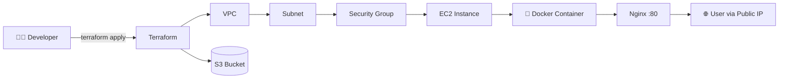

<div align="center">

# 🚀 AWS Infrastructure Automation & Portfolio Deployment

**Provisioning AWS infrastructure with Terraform and serving a personal portfolio website using Docker + Nginx**


</div>

---

## 📌 Project Overview

This project automates AWS infrastructure provisioning using **Terraform** and deploys a personal **portfolio website** inside a **Docker** container served by **Nginx**.

**Main goal:** build hands-on understanding of Infrastructure as Code (IaC), AWS cloud services, containerization, and DevOps practices.

---

## 🏗️ Architecture



---

## 🛠️ Technologies Used

| Category | Tools |
|---|---|
| ☁️ Cloud | AWS EC2, VPC, Subnets, Security Groups, S3 |
| 🧱 IaC | Terraform |
| 🐳 Containers | Docker |
| 🌐 Web Server | Nginx |
| 🔄 Version Control | Git & GitHub |
| 🎨 Frontend | HTML, CSS, JavaScript |

---

## 📂 Project Structure

```text
terraform/
│
├── .terraform/
├── .gitignore
├── .terraform.lock.hcl
│
├── provider.tf        # AWS provider configuration
├── variable.tf        # Input variables
├── vpc.tf             # VPC
├── subnet.tf          # Subnets
├── networking.tf      # Networking components
├── security.tf        # Security groups
├── ec2.tf             # EC2 instance
├── s3.tf              # S3 bucket
├── outputs.tf         # Output values
│
└── portfolio/
    ├── Dockerfile
    ├── index1.html
    ├── assets/
    │   ├── css/
    │   │   └── style.css
    │   ├── js/
    │   │   └── script.js
    │   └── images/
    ├── website-demo-image/
    └── README.md
```

---

## ☁️ AWS Infrastructure (Terraform)

| Component | Purpose |
|---|---|
| **VPC** | Creates an isolated Virtual Private Cloud |
| **Subnet** | Configures network subnets |
| **Networking** | Sets up networking components (routing, gateway) |
| **Security Groups** | Controls inbound and outbound traffic |
| **EC2** | Virtual server that hosts the container |
| **S3** | Cloud object storage |
| **Outputs** | Displays useful values (e.g. public IP) after apply |

---

## 🐳 Docker Configuration

The portfolio website is containerized using the lightweight **Nginx Alpine** image.

```dockerfile
FROM nginx:alpine

WORKDIR /usr/share/nginx/html/

# Copy website files
COPY index1.html index.html
COPY assets ./assets

EXPOSE 80

CMD ["nginx", "-g", "daemon off;"]
```

**Features**

- ⚡ Lightweight Nginx Alpine base image
- 🌐 Serves the portfolio website through Nginx
- 🔌 Exposes port `80` for HTTP traffic
- ▶️ Runs Nginx in the foreground (required for containers)

> ⚠️ **Note:** The file in `COPY` must match your real filename. Here the source is `index1.html`, which is renamed to `index.html` inside the container so Nginx serves it by default.

---

## ⚙️ Getting Started

### 1️⃣ Clone the repository

```bash
git clone https://github.com/Yaswanth-dn/<your-repo-name>.git
cd <your-repo-name>
```

### 2️⃣ Run the portfolio locally with Docker

```bash
cd portfolio
docker build -t portfolio .
docker run -d -p 8080:80 --name portfolio portfolio
```

Open 👉 **http://localhost:8080**

### 3️⃣ Deploy infrastructure with Terraform

```bash
terraform init
terraform validate
terraform plan
terraform apply
```

### 4️⃣ Deploy the website on EC2

```bash
ssh -i <your-key>.pem ec2-user@<EC2_PUBLIC_IP>
# install Docker, then build/run the container as shown above
```

Visit 👉 **http://\<EC2_PUBLIC_IP\>**

### 🧹 Clean up (avoid AWS charges)

```bash
terraform destroy
```

---

## 🔄 Git & GitHub Integration

- ✅ Initialized Git repository
- ✅ Added Terraform configuration files
- ✅ Integrated portfolio website files
- ✅ Configured `.gitignore`
- ✅ Excluded Terraform state files and sensitive configuration
- ✅ Added Dockerfile and website assets
- ✅ Created commits to track project changes

---

## 🔐 Security & Best Practices

| ❌ Never upload | ✅ Do instead |
|---|---|
| AWS Access Key / Secret Key | Use `aws configure` or environment variables |
| `.env` files | Keep them local and git-ignored |
| `.pem` / private keys | Store securely outside the repo |
| `terraform.tfstate` files | Use a remote backend (S3) |
| `.tfvars` with secrets | Git-ignore them |

Recommended `.gitignore` entries:

```gitignore
.terraform/
*.tfstate
*.tfstate.*
*.tfvars
.env
*.pem
```

---

## 📈 Project Status

- [x] Terraform configuration files created
- [x] AWS infrastructure configuration
- [x] Portfolio website integrated
- [x] Dockerfile created
- [x] Nginx configuration
- [x] Git repository initialized
- [x] GitHub repository configured
- [ ] Build Docker image
- [ ] Test portfolio container locally
- [ ] Configure Terraform remote backend
- [ ] Deploy infrastructure on AWS
- [ ] Deploy portfolio website on EC2
- [ ] Verify website using EC2 public IP

---

## 🎯 Learning Outcomes

- 🧱 Infrastructure as Code (IaC) with Terraform
- ☁️ AWS cloud infrastructure management
- 🐳 Docker containerization
- 🌐 Nginx web server configuration
- 🔄 Git and GitHub version control
- 🚀 DevOps project structure and integration

---

## 👨‍💻 Author

**Yaswanth**

[](https://github.com/Yaswanth-dn)

---

<div align="center">

⭐ If you found this project helpful, consider giving it a star!

</div>
